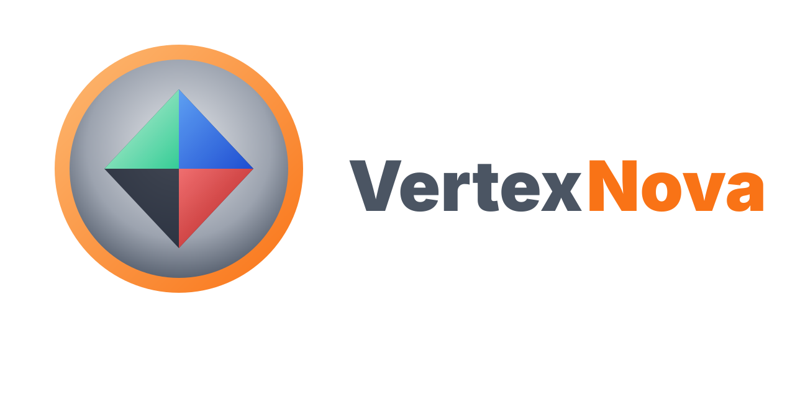

<p align="center">
  
</p>

<p align="center">
  <strong>Minimal C++ project template for the VertexNova ecosystem</strong>
</p>

<p align="center">
  <a href="https://github.com/vertexnova/vnexr/actions/workflows/ci.yml">
    
  </a>
  
  <a href="https://codecov.io/gh/vertexnova/vnexr">
    
  </a>
  
</p>

---

# VneXR

VertexNova **XR session / compositor** library (OpenXR + vnerhi). Learning path (Ubuntu 24.04 -> Monado -> Galaxy XR): [docs/vertexnova/xr/learning_path.md](docs/vertexnova/xr/learning_path.md). Agent playbooks: [skills/](skills/).

## Directory layout

| Path | Description |
|------|-------------|
| `cmake/vnecmake/` | CMake modules submodule (ProjectSetup, ProjectWarnings, VneUseDep) |
| `configs/` | Configured headers (e.g. `config.h.in`) |
| `deps/external/` | Third-party deps (e.g. googletest) |
| `deps/internal/` | VertexNova internal libs (vnecommon, vnelogging) |
| `include/` | Public API headers (`vertexnova/xr/`) |
| `src/` | Implementation |
| `tests/` | Unit tests (Google Test) |
| `docs/` | Doxygen input (`doxyfile.in`) and extra docs |
| `scripts/` | Helper scripts (build, format, generate-docs) |

## Prerequisites

- **CMake** 3.19 or newer  
- **C++20** compiler (e.g. GCC 10+, Clang 10+, MSVC 2019+)  
- **Doxygen** (optional, for `scripts/generate-docs.sh` and `-DENABLE_DOXYGEN=ON`)

## Dependencies

- **External:** Tests use [Google Test](https://github.com/google/googletest). Either add `deps/external/googletest` as a submodule (recommended tag: `v1.17.0`) or let CMake use FetchContent when the directory is missing.  
- **Internal:** **vnecmake** (required) is the CMake modules submodule at `cmake/vnecmake`. Optional libraries `vnecommon` and `vnelogging` go under `deps/internal/`. See [deps/README.md](deps/README.md). If they are missing, the template still builds but does not link to `vne::common` or `vne::logging`.

From the project root:

```bash
git submodule update --init --recursive
```

(Add submodules first if your repo uses them; see `deps/README.md`.)

## Build

Builds use **`build/static`** or **`build/shared`** (one library type per directory). From the project root:

```bash
# Shared library (default)
cmake -B build/shared -DCMAKE_BUILD_TYPE=Debug -DVNE_XR_TESTS=ON
cmake --build build/shared

# Static library
cmake -B build/static -DCMAKE_BUILD_TYPE=Debug -DVNE_XR_LIB_TYPE=static -DVNE_XR_TESTS=ON
cmake --build build/static
```

Or use the platform scripts (they use `build/<lib_type>/...`):

```bash
# macOS (default: shared)
./scripts/build_macos.sh -t Debug -a configure_and_build
./scripts/build_macos.sh -l static -t Release -a configure_and_build   # static in build/static/...

# Linux
./scripts/build_linux.sh -t Debug -a configure_and_build
./scripts/build_linux.sh -l static -c clang -a test

# Linux OpenXR (Monado / desktop VR)
./scripts/install_linux_openxr_deps.sh
./scripts/build_linux.sh -t Debug -a configure_and_build --with-openxr --with-examples

# Windows (Visual Studio Developer Command Prompt). Python, PowerShell, and Bash
# share build/<lib>/<config>/build-windows-cl-<cl-version>.
python scripts\build_windows.py -t Debug -a configure_and_build --with-openxr
python scripts\build_windows.py -t Debug -a run --with-openxr --sample null_simulator
python scripts\build_windows.py -t Debug -a run --with-openxr --sample stereo_cube
```

Options: `-t` / `-BuildType` build type, `-a` / `-Action` action, `-l` / `-LibType` lib type (`static` | `shared`, default `shared`), `-clean` / `-Clean`, `-j N` / `-Jobs N`. macOS script also supports `-xcode` for Xcode project.

The Windows scripts additionally build the OpenXR backend with Vulkan (implies samples), run one sample through `vnexr_samples` with `-a run`, and select an OpenXR runtime for that run. Option spelling differs per script. Details: [scripts/README.md](scripts/README.md#windows).

| Purpose | `build_windows.py` / `build_windows.sh` | `build_windows.ps1` |
|---------|-----------------------------------------|---------------------|
| OpenXR backend + Vulkan | `--with-openxr` | `-WithOpenXR` |
| Sample for `-a run` | `--sample <name>` | `-Sample <name>` |
| OpenXR runtime manifest | `--runtime-json <path>` | `-RuntimeJson <path>` |

The Quest 3 walkthrough is in [Windows laptop setup](#windows-laptop-setup) below.

## Windows laptop setup

Two ways to see `stereo_cube` on a Quest 3. Do them in this order: the PC sample through Meta Quest Link, then the on-headset APK. The desktop build does not need Android Studio.

### 1. Tools

Install these before the first compile:

- **Visual Studio 2022** with the Desktop development with C++ workload. `cl` is not on the normal PATH. Use a **Visual Studio Developer Command Prompt**, or call `VsDevCmd.bat` first (`Common7\Tools\VsDevCmd.bat -arch=x64 -host_arch=x64`).
- **CMake** 3.26 or newer, **Python 3**, and **Git for Windows** (the APK script is bash, so Git Bash is required).
- **LunarG Vulkan SDK**, which sets `VULKAN_SDK`. The run step puts `%VULKAN_SDK%\Bin` on `PATH` so the loader DLLs resolve.
- SSH access to the private `vnerhi` repository, then from the repo root: `git submodule update --init --recursive`.

### 2. Desktop OpenXR build

From that Visual Studio prompt, in the repo:

```bat
python scripts\build_windows.py -t Debug -a configure_and_build --with-openxr
python scripts\build_windows.py -t Debug -a run --with-openxr --sample null_simulator
```

`--with-openxr` turns on the OpenXR backend, Vulkan, and the samples. The launcher is `build\shared\Debug\build-windows-cl-*\bin\samples\Debug\vnexr_samples.exe`. Shared DLLs land in `bin\Debug`. `run` prepends that folder and the Vulkan SDK `Bin` directory to `PATH`.

`null_simulator` needs no headset. Success is five `Null simulator frame N` lines and exit code 0. `vnexr_samples.exe --list` includes `stereo_cube`.

### 3. Quest Link (PC sample in the headset)

1. Install the **Meta Quest Link** PC app. A data-capable USB-C cable is the reliable first connection.
2. Put on the Quest 3, accept the Link connection, and stay in the Link home.
3. In the Link app: Settings, General, **Set Meta Quest Link as active OpenXR runtime**.
4. Rerun the sample that is already built:

```bat
python scripts\build_windows.py -t Debug -a run --with-openxr --sample stereo_cube
```

A good log, in order, is `OpenXR Vulkan context ready`, then `OpenXR session initialized`, then frames in the headset. The sample stops itself after 3600 frames (about a minute). If the log says the registry has no active runtime, Link is not the active OpenXR runtime. If it says `XR_ERROR_FORM_FACTOR_UNAVAILABLE`, the headset is not in the Link session.

### 4. Android Studio SDK (needed only for the APK)

Install Android Studio, then in SDK Manager install:

- Android SDK Platform **36** and Build-Tools **36.0.0** (the sample compiles against API 36)
- Android SDK Platform-Tools (`adb`)
- NDK (Side by side). Quest 3 is `arm64-v8a`
- CMake (the package includes `ninja.exe`). The Android script uses Ninja. The Visual Studio CMake generator cannot drive the NDK toolchain

The default SDK location is `%LOCALAPPDATA%\Android\Sdk`. The JDK is Android Studio's JBR at `C:\Program Files\Android\Android Studio\jbr`. `scripts/build_android.sh` looks in those places, and also accepts `adb.exe`.

The generated project uses Android Gradle Plugin 9.0.1, which needs **Gradle 9.1 or newer**. The script uses `gradle` from `PATH` (or `GRADLE_DIR`, a project that contains a newer `gradlew`) and stops with a message if it is older. Otherwise it falls back to the newest `gradle.bat` that Android Studio has already downloaded under `%USERPROFILE%\.gradle\wrapper\dists`. On a clean machine install Gradle 9.1 or newer (`brew install gradle` on macOS) and put it on `PATH` so the build does not depend on Android Studio having synced a project.

### 5. Developer mode

1. In the **Meta Horizon** phone app: the Quest 3, headset settings, turn on **Developer mode**. The headset reboots.
2. Connect USB-C, put on the headset, and allow USB debugging.
3. Confirm the PC sees it: `adb devices` shows the headset as `device`, not `unauthorized`.

### 6. Build and install the APK

From **Git Bash** in the repo:

```bash
export ANDROID_HOME="$LOCALAPPDATA/Android/Sdk"
export ANDROID_NDK_ROOT="$(ls -d "$ANDROID_HOME"/ndk/* | sort -V | tail -1)"
./scripts/build_android.sh -t Debug -a run -sample stereo_cube -abi arm64-v8a
```

The two exports are optional when the SDK is in the default Windows location. The script picks the newest installed NDK, configures with Ninja, and on Windows writes the build under `build/android/` (a short folder such as `arm64-v8a-debug-shared-ndk27`, so native object paths stay short enough for Windows). The script prints the exact build folder and APK path. `-a run` installs `com.vertexnova.vnexr.samples` and launches `stereo_cube`. Expect the app in the headset library and the same cubes, with hand pinch/grasp when `XR_EXT_hand_interaction` is available.

If no headset is connected yet, build the APK without installing:

```bash
./scripts/build_android.sh -t Debug -a apk -sample stereo_cube -abi arm64-v8a
```

The script prints the APK path. It is `app-samples-debug.apk` under `<build folder>/android-studio/app/build/outputs/apk/samples/debug/`. If the view is black, capture `adb logcat -s vne.xr:* OpenXR:*` and stop there.

## Test

```bash
ctest -C Debug --test-dir build/shared
# or for static: ctest -C Debug --test-dir build/static
```

Or:

```bash
./scripts/build_macos.sh -a test
```

## Documentation

- **Template overview and diagrams:** [docs/vertexnova/xr/xr.md](docs/vertexnova/xr/xr.md) — context and API diagrams (Draw.io sources in `docs/vertexnova/xr/diagrams/`).
- **API docs:** Configure with Doxygen enabled and build the doc target:

  ```bash
  cmake -B build/shared -DENABLE_DOXYGEN=ON
  cmake --build build/shared --target vnexr_doc_doxygen
  ```

  Output: `build/shared/docs/html/index.html`.

- **Script:** From project root:

  ```bash
  ./scripts/generate-docs.sh
  ```

  Use `--api-only` to only generate API docs, or `--validate` to only check links and coverage. See `./scripts/generate-docs.sh --help`.

## Format and tidy

- **clang-format:** Config in [.clang-format](.clang-format). Format in place or check only (CI):
  ```bash
  ./scripts/format.sh          # format sources
  ./scripts/format.sh -check   # check only (used in CI)
  ```
- **clang-tidy:** Config in [.clang-tidy](.clang-tidy). Generate `compile_commands.json` (e.g. `cmake -DCMAKE_EXPORT_COMPILE_COMMANDS=ON -B build/shared`), then run `clang-tidy -p build/shared`.

## CI

GitHub Actions runs on push and pull requests to `main`: format check, clang-tidy, and build/test on Linux (GCC, Clang), macOS, and Windows. See [.github/workflows/ci.yml](.github/workflows/ci.yml).

## Contributing

See [CONTRIBUTING.md](CONTRIBUTING.md) for build, test, and style. We follow the [Contributor Covenant](CODE_OF_CONDUCT.md) Code of Conduct.

## Releases

Releases are manual. The **VERSION** file at the repo root is the source of truth; CMake reads it at configure time and exposes it as `getVersion()`.

To cut a release: update **VERSION**, add a dated entry to **CHANGELOG.md**, commit, create and push a tag (e.g. `git tag v1.0.0 && git push origin v1.0.0`), then create a GitHub Release from that tag and paste the CHANGELOG section.

## License

See [LICENSE](LICENSE).
